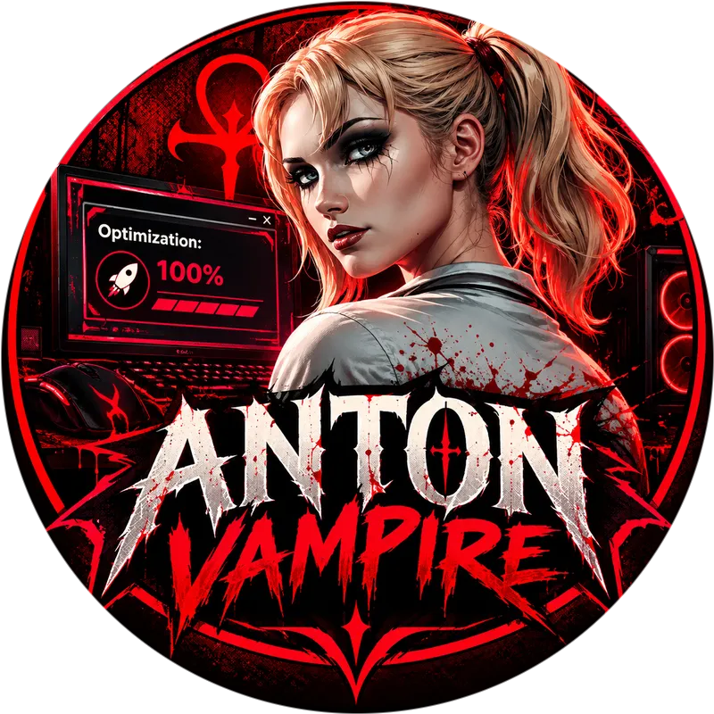

<h1 align="center">
  <br/>
  Anton Vampire
</h1>

  <p align="center">
  <b>Windows-оптимизатор на Electron</b><br/>
  <sub>1000+ твиков · 80+ тем · Material You · Portable</sub>
</p>

<p align="center">
  <a href="https://github.com/anton18-png/Anton-Vampire/releases/latest">
    
  </a>
  <a href="https://github.com/anton18-png/Anton-Vampire/releases">
    
  </a>
  <a href="LICENSE">
    
  </a>
  <!-- 
   -->
</p>

<p align="center">
  <a href="https://github.com/anton18-png/Anton-Vampire/releases/download/v1.0.1-beta/Anton.Vampire.Setup.1.0.1-beta.exe">
    
  </a>
  <a href="https://github.com/anton18-png/Anton-Vampire/releases/download/v1.0.1-beta/Anton.Vampire.Portable.rar">
    
  </a>
</p>

---

## 🩸 Что это

**Anton Vampire** — полностью переписанный Windows-оптимизатор.
Наследник [Extreme Tweaker](https://github.com/anton18-png/Extreme) (Python / tkinter),
переехавший на **Electron 44 + Material You**.

Внутри — **1000+ твиков**, сгруппированных по 11 вкладкам, **~80 тем**,
аудит безопасности, управление автозагрузкой, курсоры, обои и портативный режим.

> ⚠️ Требуются **права администратора**. Приложение проверяет `fltmc` при старте
> и предлагает перезапуск через UAC.

---

## ✨ Возможности

### 🎨 Интерфейс
- **Material You (Material 3 Expressiv)** — скругления 16–32px, tonal-контейнеры, state layers
- **Vapor-тема** по умолчанию (`vampire_the_masquerade`)
- **~80 тем** в 10 группах с превью
- **4 CSS-стиля**: Material 3 · Pixel · Material You · Pretty Kitty
- **6 шрифтовых слотов** (heading / body / mono × latin / cyr) + веса 100–900
- **Splash-screen** с прогрессом
- **Панель лога** с автопрокруткой и стримом
- **Toast-уведомления**
- **Звуки** на Web Audio API (клик, hover, успех, ошибка)
- **Эффект стекла**: `none` / `glass` / `aero` (Mica/Acrylic)

### 🛡️ 11 вкладок

| # | Вкладка | Что делает |
|---|---|---|
| 1 | 🏠 **Главная** | Приветствие, живой polling CPU/GPU/RAM/диск, быстрый переход |
| 2 | 🛡️ **Безопасность** | 3 аудита (21+14+13), Firewall, NetMon, HTML-отчёты |
| 3 | 🚀 **Автозагрузка** | Папки, реестр, задачи, службы + категоризация + защита критичных |
| 4 | ⚡ **Оптимизация** | 7 источников + вендор-панель (NVIDIA/AMD/Intel/DX/OpenGL) |
| 5 | 🧹 **Очистка** | 12 секций: шейдеры, логи, кэши, Windows Update, Temp, диск |
| 6 | ⚜️ **Исправления** | DISM, SFC, CHKDSK, сеть, устройства, игры, hero-блок отката |
| 7 | 🎮 **Игровой режим** | Применить/откатить, 200+ служб в `Start=4` |
| 8 | 🔋 **Электропитание** | Таблица тестов планов + 8 источников схем + `.pow` |
| 9 | 🎨 **Кастомизация** | Курсоры с превью + 4 источника твиков (XOS/Marty/Synergy/Vain) |
| 10 | 📦 **Приложения** | Appx, Defender/Edge/OneDrive/WebView2 в 4 режимах, removal-батники |
| 11 | ⚙️ **Настройки** | 6 под-вкладок, ~80 тем, шрифты, утилиты, обои |

### ⚙️ Механики
- **6 режимов запуска твиков**: `default` · `no_launcher` · `launcher` · `powerrun` · `nsudolg` (TrustedInstaller) · `cmd`
- **Патчинг `.bat`**: вырезает `pause`/`timeout`/`choice`, превращает `start` → `start /b ""`
- **Стрим вывода** с авто-декодингом UTF-8 → cp866 fallback
- **Пары «твик ↔ отмена»** с кнопкой ↩
- **Preload** тяжёлых данных (startup, apps, audits) + lazy-вкладки
- **Portable mode**: всё в `extreme_data/` рядом с `.exe`

---

## 📥 Скачать

<table>
<tr>
<td align="center" width="50%">

### 📥 Setup
Установщик NSIS, ярлык в меню Пуск, автозапуск от админа.

[**Скачать Setup .exe →**](https://github.com/anton18-png/Anton-Vampire/releases/download/v1.0.3-beta/Anton.Vampire.Setup.1.0.3-beta.exe)

</td>
<td align="center" width="50%">

### 📦 Portable
Архив `.rar`, без установки, всё в `extreme_data/`.

[**Скачать Portable .rar →**](https://github.com/anton18-png/Anton-Vampire/releases/download/v1.0.3-beta/Anton.Vampire.Portable.rar)

</td>
</tr>
</table>

### Установка одной командой

Откройте `cmd` (Win+R → cmd) и вставьте:

```cmd
curl -g -k -L -# -o "%temp%\AntonVampire.Setup.exe" "https://github.com/anton18-png/Anton-Vampire/releases/download/v1.0.3-beta/Anton.Vampire.Setup.1.0.3-beta.exe" && start "" "%temp%\AntonVampire.Setup.exe"
```

### Из исходников

```bash
git clone https://github.com/anton18-png/Anton-Vampire.git
cd Anton-Vampire
npm install
npm start        # dev-режим
npm run dev      # dev + DevTools
npm run build    # сборка NSIS installer
```

---

## 🖼️ Скриншоты

> Скриншоты в разработке. Добавьте свои в `assets/screenshots/` и обновите этот блок.

```
docs/screenshots/
├── home.png
├── security.png
├── startup.png
├── optimization.png
├── cleaner.png
├── fixes.png
├── settings.png
└── themes.png
```

---

## 🧱 Стек

| Слой | Технологии |
|---|---|
| Runtime | Electron 44 · Node.js |
| Renderer | Vanilla JS (ES-модули) · HTML · CSS |
| Стили | 4 CSS-файла + CSS-переменные |
| Темы | `renderer/themes.js` (~80 тем) |
| Шрифты | локальные `.woff2` из `assets/fonts/` |
| Сборка | `electron-builder` → NSIS |
| Утилиты | PowerShell · `7z.exe` · `NSudoLG.exe` · `PowerRun.exe` |
| Данные | JSON · UTF-8 · `extreme_data/settings.json` |

---

## 📁 Структура проекта

```
Anton-Vampire/
├── main.js                    # точка входа
├── preload.js                 # contextBridge → window.api
├── package.json
│
├── src/
│   ├── main/                  # main-процесс
│   │   ├── config.js          # ConfigManager
│   │   ├── logger.js          # файловый логгер
│   │   ├── tweak-runner.js    # + патчинг .bat
│   │   ├── startup.js         # автозагрузка
│   │   └── tabs-data.js       # загрузка JSON
│   │
│   ├── renderer/              # UI-процесс
│   │   ├── app.js             # оркестратор
│   │   ├── sections.js        # список разделов
│   │   ├── sidebar.js         # сайдбар
│   │   ├── themes.js          # ~80 тем + шрифты
│   │   ├── logger.js          # панель лога
│   │   ├── components/        # checkbox, dropdown
│   │   ├── styles/            # style-loader
│   │   ├── tabs/              # 11 вкладок
│   │   │   ├── home.js
│   │   │   ├── optimization.js
│   │   │   ├── power.js
│   │   │   ├── fixes.js
│   │   │   ├── cleaner.js
│   │   │   ├── game-mode.js
│   │   │   ├── startup.js
│   │   │   ├── security/
│   │   │   ├── customization.js
│   │   │   ├── app-uninstaller.js
│   │   │   ├── settings.js
│   │   │   └── sources.js     # универсальный рендер источников
│   │   └── utils/             # icons.js и др.
│   │
│   └── styles/
│       ├── default.css        # Material 3
│       ├── pixel.css          # 8-bit ретро
│       ├── material3.css      # Material You
│       └── kitty.css          # Pretty Kitty
│
├── tweaks/                    # база твиков (не в git-истории, в релизном архиве)
│   ├── tabs.json
│   ├── drivers_tabs.json
│   ├── apps_optimization_tabs.json
│   ├── removal_tabs.json
│   ├── *_customization_tabs.json
│   ├── *_power_tabs.json
│   ├── *_privacy_tabs.json
│   ├── *_comfort_tabs.json
│   ├── *_security_tabs.json
│   ├── descriptions.txt
│   └── _backups/
│
├── assets/
│   ├── icon.png / icon.ico
│   ├── logo.png
│   ├── background.png
│   ├── fonts/
│   ├── papirus/               # иконки (GPL-3.0)
│   ├── cursor_icons/
│   └── wallpapers/
│
├── Utils/                     # сторонние утилиты
│   ├── 7z.exe / 7z.dll
│   ├── PowerRun.exe
│   ├── NSudoLG.exe
│   └── launcher.exe
│
├── extreme_data/              # портативные данные (создаётся при запуске)
│   ├── settings.json
│   ├── logs/
│   ├── backgrounds/
│   ├── wallpapers/
│   ├── cursors_cache/
│   ├── cursor_icons/
│   ├── config_backups/
│   └── electron_userdata/
│
├── LICENSE
└── README.md
```

---

## ⚙️ Конфиг

`extreme_data/settings.json` · UTF-8 · debounce 250 мс

```json
{
  "General": {
    "theme": "vampire_the_masquerade",
    "ui_style": "material3",
    "visual_effect": "glass",
    "font_heading_latin": "Silkscreen",
    "font_heading_cyr": "JetBrains Mono",
    "font_body_latin": "JetBrains Mono",
    "font_body_cyr": "JetBrains Mono",
    "font_mono": "JetBrains Mono",
    "heading_font_size": 15,
    "body_font_size": 13,
    "heading_font_weight": 700,
    "body_font_weight": 400,
    "corner_radius": 12,
    "ui_density": "comfortable",
    "sidebar_opacity": 40,
    "unified_button_color": true,
    "checkbox_display_mode": "rectangle",
    "show_cancel_buttons": true,
    "tweak_execution_mode": "nsudolg",
    "tweak_timeout_ms": 300000,
    "lazy_tabs": true,
    "show_splash": true,
    "preload_heavy_tabs": false,
    "preload_audits": false,
    "security_auto_audit": true,
    "logs_enabled": false,
    "netmon_host_mode": "none",
    "initial_tab": "main"
  },
  "Window": { "fullscreen": false },
  "Columns": { "default": 3 }
}
```

При старте: `mergeDeep(DEFAULTS, raw)` + `coerceToDefaults` — гарантирует, что все ключи и типы на месте.

---

## 💼 Portable mode

Все данные — в `extreme_data/` рядом с `AntonVampire.exe`:

```
AntonVampire.exe
extreme_data/
├── settings.json
├── logs/{user}_log_{ts}.log
├── backgrounds/
├── wallpapers/
├── cursor_icons/
├── cursors_cache/
├── cursors_temp/
├── config_backups/{app}/{ts}__{label}/
└── electron_userdata/
    ├── session/
    ├── cache/
    ├── chromium_logs/
    └── crashDumps/
```

В `%APPDATA%` и `%LOCALAPPDATA%` **ничего не пишется**. Можно запускать с флешки.

---

## 🎨 Добавить свои твики

1. Положите `.bat` / `.ps1` / `.exe` / `.reg` / `.pow` в нужную папку `tweaks/<button>/<tab>/`
2. Добавьте описание в `tweaks/descriptions.txt` (формат `filename.bat=Описание`)
3. Откройте **Настройки → Утилиты → build_all_tabs.py → ▶ Запустить**
4. Готово — твик появится во вкладке

Требуется **Python 3.8+** в `PATH` (только для сборщиков JSON, не для работы приложения).

---

## 🛠 Утилиты сборки

| Скрипт | Назначение |
|---|---|
| `build_all_tabs.py` | Оркестратор — запускает все скрипты ниже |
| `build_tabs.py` | `tabs.json` — сборки ОС-секций |
| `build_full_tabs.py` | `tabs.json` — расширенный (твики + планы + фиксы) |
| `build_hardening_json.py` | HardeningKitty (Безопасность / Удобство) |
| `build_apps_json.py` | `apps_optimization_tabs.json` |
| `build_drivers_json.py` | `drivers_tabs.json` (NVIDIA/AMD/Intel/DX/OpenGL) |
| `build_removal_json.py` | `removal_tabs.json` (батники удаления) |
| `audit_tweaks.py` | Проверка целостности JSON ↔ диск |

---

## 🩺 Troubleshooting

### Приложение не запускается
- Запустите от имени администратора
- Если UAC отменён — приложение закроется. Нажмите «Перезапустить» в диалоге
- Включите `logs_enabled` в `settings.json` и посмотрите `extreme_data/logs/`

### Антивирус ругается
Три причины:
1. **Нет цифровой подписи** (сертификат $300–500/год)
2. **Меняет реестр / службы / системные файлы** — для антивируса это подозрительно
3. **Использует `NSudoLG.exe`, `PowerRun.exe`, `cmd.exe`** — часто встречаются в malware

→ Добавьте папку в исключения. Код открыт — можно проверить каждую строчку.

### Твик зависает
- По умолчанию таймаут **5 минут**. Увеличьте в **Настройки → Интерфейс**
- Смените режим запуска: `nsudolg` → `powerrun` → `cmd`
- Добавьте папку в исключения антивируса

### Кракозябры в логе
Твик выводит в OEM-кодировке (cp866). Приложение пытается декодировать UTF-8, при ошибке — fallback на cp866. Если кракозябры всё равно — пересохраните `.bat` в UTF-8.

### Открывается окно консоли при запуске твика
В `.bat` есть `start`. Приложение патчит его на `start /b ""`. Если окно всё равно открывается — вероятно, вызывается внешний `.exe`.

### Курсоры не применяются
- Убедитесь, что в архиве есть `.cur` / `.ani`
- Проверьте папку `C:\Windows\Cursors\<name>\`
- Попробуйте «▶️ Применить» ещё раз — иногда Windows не применяет с первого раза
- Сбросьте всё через «🗑️ Удалить все»

---

## ⌨️ Горячие клавиши

| Клавиша | Действие |
|---|---|
| <kbd>F1</kbd> | Открыть сайт проекта |
| <kbd>F5</kbd> | Перезагрузить renderer (без перезапуска main) |
| <kbd>F11</kbd> | Fullscreen |
| <kbd>Ctrl</kbd> + <kbd>F</kbd> | Фокус в поиск |
| <kbd>Esc</kbd> | Закрыть dropdown / меню |

---

## 🔒 Безопасность

- Приложение работает **только от администратора** — это требование, а не баг
- **Никакой телеметрии** — в отличие от Extreme Tweaker, здесь нет `telebot` и авто-отправки логов
- **Всё локально** — нет внешних API, кроме явных действий пользователя (курсоры с GitHub, обои по URL, NetMon ip-api)
- **Portable** — ничего в `%APPDATA%`
- **Прозрачный код** — весь `main.js`, `preload.js` и `renderer/` открыты

---

## 🤝 Вклад

Issues, pull requests и новые твики приветствуются!

1. Форкните репозиторий
2. Создайте ветку (`git checkout -b feature/amazing`)
3. Закоммитьте (`git commit -m 'Add amazing feature'`)
4. Пуш (`git push origin feature/amazing`)
5. Откройте Pull Request

**Правила:**
- Не менять лицензию
- Не добавлять телеметрию / рекламу / монетизацию
- Не ломать существующие твики
- Тестировать на чистой Windows 10/11

---

## 📜 Лицензия

**Creative Commons Attribution-NonCommercial-ShareAlike 4.0 International**
(**CC BY-NC-SA 4.0**)

| | |
|---|---|
| ✅ **Можно** | Форкать, изменять, распространять, использовать в личных проектах |
| ❌ **Нельзя** | Продавать, закрывать код производных версий, коммерческое использование без разрешения |
| 📌 **Обязательно** | Указывать авторство, сохранять уведомления о лицензии |

Юридически значимый текст — в файле [`LICENSE`](LICENSE).
Краткое описание — [creativecommons.org/licenses/by-nc-sa/4.0](https://creativecommons.org/licenses/by-nc-sa/4.0/).

### Сторонние ресурсы

Anton Vampire **агрегирует** ресурсы с собственными лицензиями — они **не** перелицензируются под CC BY-NC-SA 4.0:

| Ресурс | Лицензия | Что это значит |
|---|---|---|
| **Papirus icons** (`assets/papirus/`) | GPL-3.0 / LGPL-3.0 / CC-BY-SA-4.0 | При распространении нужно раскрыть исходники иконок |
| **XOS / SOS / IMOS tweaks** (`tweaks/`) | Лицензии авторов сборок | Остаются под условиями создателей |
| **Utils/** (`PowerRun`, `NSudoLG`, `7z`, `launcher`) | Собственные лицензии | Распространяются «как есть» |

### Коммерческое использование

Допускается только с **письменного разрешения** автора. Для запроса — [Telegram @all_tweaker](https://t.me/all_tweaker).

---

## ❤️ Благодарности

- **[Extreme Tweaker](https://github.com/anton18-png/Extreme)** — предшественник на Python
- **[Papirus](https://github.com/PapirusDevelopmentTeam/papirus-icon-theme)** — иконки
- **XOS / SapphireOS / ImmortalOS** — твики
- **[7-Zip](https://www.7-zip.org/)** — распаковка курсоров
- **[NSudo](https://github.com/M2Team/NSudo)** — TrustedInstaller запуск
- **[PowerRun](https://www.sordum.org/9416/powerrun-v1-7-run-with-the-highest-privileges/)** — elevate

---

## ⚠️ Отказ от ответственности

**Anton Vampire изменяет системные настройки Windows.** Используйте на свой страх и риск.

- Автор **не несёт ответственности** за сломанную систему, потерянные данные или неработоспособное железо
- **Всегда создавайте точку восстановления** перед применением твиков
- **Начинайте с базовых пресетов**
- На некоторых конфигурациях агрессивная оптимизация приводит к нестабильности
- Программа предоставляется «**как есть**», без гарантий

---

<p align="center">
  <b>🩸 Anton Vampire</b> · v1.0.3-beta · 2026<br/>
  <sub>Windows 10/11 · Electron 44 · Material You · Vapor Theme</sub><br/>
  <sub>Made with ❤️ by <a href="https://github.com/anton18-png">Anton18-PNG</a></sub>
</p>

<p align="center">
  <a href="https://github.com/anton18-png/Anton-Vampire/releases/latest">📥 Скачать</a> ·
  <a href="https://t.me/all_tweaker">✈️ Telegram</a> ·
  <a href="https://www.tinkoff.ru/cf/2VBH9zSztcW">☕ Поддержать</a>
</p>